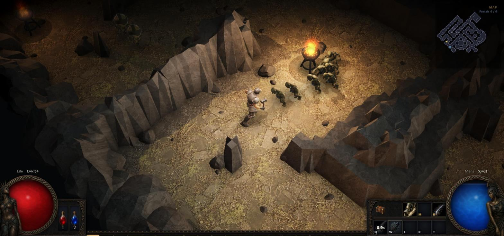
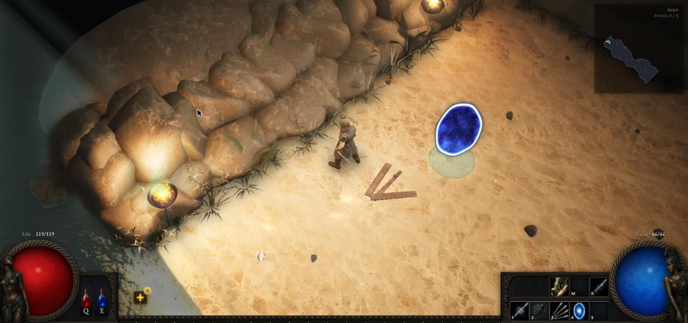
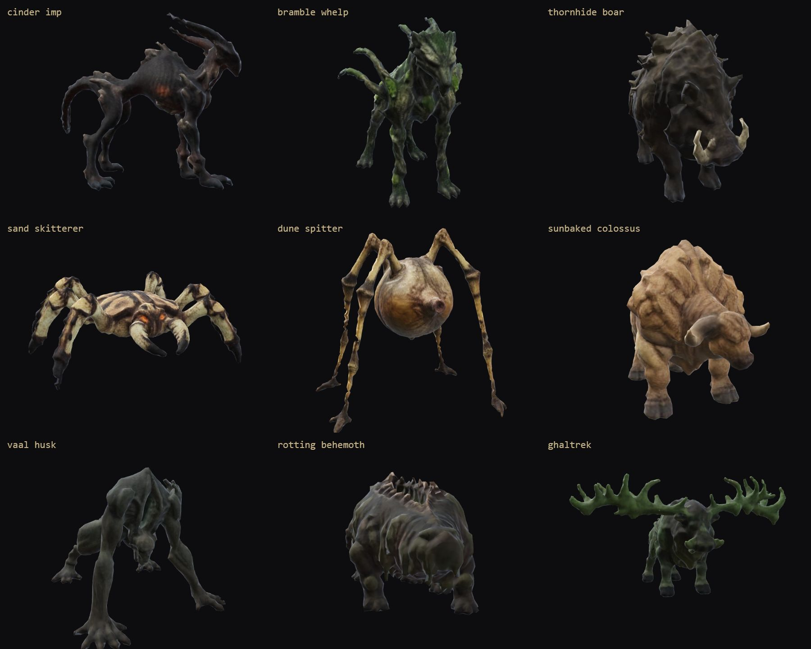
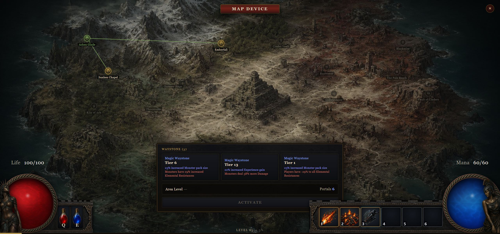
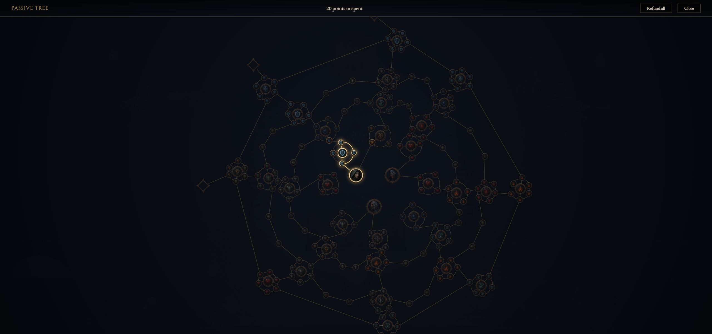
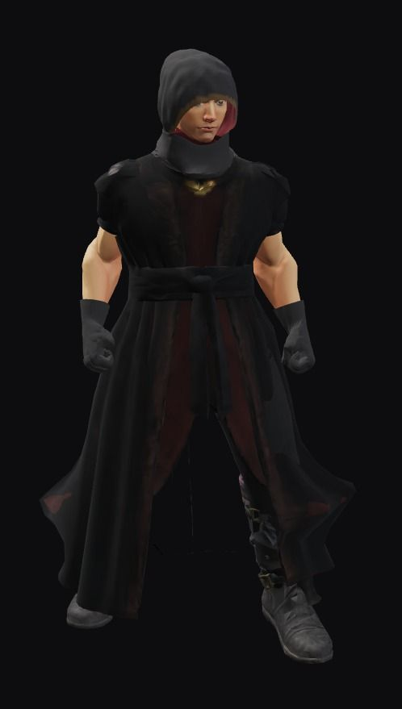

# Exiled Casual

[Website](https://exiledcasual.com) · [Devlog](devlog/README.md)

An original browser-native action RPG inspired by Path of Exile 1 **and** 2, taking the best of
either where they differ. It is not a clone of either game. Borrowed design ideas name their
source in the code and docs, while the implementation, world, art, and content remain original.

The public website is a teaser. The game itself is an active work in progress and currently runs
locally.

## What is playable now

- Deterministic 30 Hz combat with class-specific default attacks, skills, ailments, buffs,
  animated creature strikes, and four two-phase bosses.
- Three classes (Ironsworn, Stalker, Emberbound), click-to-move or WASD controls, and a dodge roll.
- A hideout and six-portal run loop, procedural biome maps, and an open coastal Strand with surf,
  wet sand, shells, driftwood, and wreckage.
- An Atlas at the map device, where a Waystone socketed from the inventory opens a map, with
  Waystone modifiers and fog; inside a map, a minimap and a centred Tab overlay.
- Normal, magic, rare, and unique items with affixes, implicits, identification, crafting orbs,
  loot beams, stash, vendor, disenchanting, and equipment-derived stats.
- A 239-node passive tree across eight disciplines, with class start doors, notables that open once
  their cluster is mostly taken, travel bridges, keystones that trade one stat for another, and
  per-node refunds.
- A rigged 3D character with visible equipped gear, animated cloth, positional audio, music,
  ambience, and a game shell covering menus, character selection, loading, options, and local saves.
- Options that reach the whole game: graphics and audio mixes, HUD toggles, rebindable keys, and a
  debug-logging channel that narrates a run to the console.

Balance is measured rather than final, and no public playable build is available.

## How it is built

Every slice starts from a written spec. The [`docs/`](docs/) folder holds a clean-room research
pack (game mechanics reconstructed from public sources) plus the per-slice specs and plans that
were implemented against it:

- [`docs/README.md`](docs/README.md) - the research pack index and design invariants
- [`docs/specs/`](docs/specs/) - per-slice design specs
- [`docs/plans/`](docs/plans/) - the task-by-task implementation plans

Two project rules keep the output grounded: real game screenshots are checked before UI or render
work, and item and affix mechanics are researched against public databases rather than invented.
Because both games are drawn on, a borrowed mechanic or look says in the code which game it came
from.

## Devlog

Major visible milestones, in screenshots and short notes, are in [`devlog/`](devlog/README.md).

<table>
<tr>
<td width="33%"><br><sub>Blackmire walls meeting the floor.</sub></td>
<td width="33%"><br><sub>A cliff on the Strand.</sub></td>
<td width="33%"><br><sub>The generated monster roster.</sub></td>
</tr>
<tr>
<td width="33%"><br><sub>The Atlas.</sub></td>
<td width="33%"><br><sub>The passive tree.</sub></td>
<td width="33%"><br><sub>The Emberbound in a robe.</sub></td>
</tr>
</table>

## Tech stack

| | |
|---|---|
| Language | TypeScript 7, strict, ES modules, npm workspaces monorepo |
| Client | React 19 + Babylon.js 9 (WebGL2), Vite 8 |
| Simulation | Hand-rolled ECS, 30 Hz fixed timestep, runs in a Web Worker |
| Determinism | Fixed-point integers only, named seeded RNG streams, replayable to a checksum |
| Persistence | IndexedDB, versioned character roster and shared stash; JSON import/export |
| Tests | Vitest (+ Testing Library and jsdom for the HUD) |
| Asset pipeline | Blender 5.2 headless via Python (`tools/`) for the rig, monsters, gear, props and rocks; Pillow scripts for tilesets, icons and textures |
| Art | Generated raster masters, then re-palettized or made tiling offline. No runtime asset generation. |
| CI | GitHub Actions on pushes to `main` and on pull requests: a `build` job (typecheck, tests, web build, bundle-size check) and a `smoke` job (Playwright) |

The current build has no remote game server. Its authority boundary is the simulation worker: the
client sends intents, never outcomes, and the simulation re-validates range, tier, cost, and
placement.

## Layout

npm workspaces, TypeScript throughout.

| Path | What it is |
|---|---|
| `packages/fixed-point` | Deterministic fixed-point integer math |
| `packages/simulation` | ECS combat simulation, 30 Hz fixed timestep |
| `packages/mapgen` | Procedural map generation |
| `packages/rules` | Pure rules engine (imports only `@exiled/fixed-point` and `@exiled/content-schema`) |
| `packages/content-schema`, `packages/content-runtime` | Content types and validation, and the authored content (classes, items, monsters, skills, maps) |
| `packages/protocol` | Message contracts between the client and the simulation worker |
| `packages/replay` | Replay a run from its seed and command log |
| `packages/persistence` | Saves: IndexedDB character roster and shared stash |
| `apps/web` | React + Babylon.js client (Vite); the sim runs in `src/worker/` |
| `tools/` | Offline asset builders (Blender headless, Pillow). Never run at runtime. |

The simulation is deterministic: fixed-point integers only, every random draw comes from a
named seeded stream, so a run replays to an identical checksum.

## Quick start

Prerequisites: Node 22.16.0 or newer, as pinned in [`.node-version`](.node-version) (`nvm use`
or `fnm use` picks it up), and npm 11.7.0, as declared by `packageManager` in
[`package.json`](package.json). CI installs the same version through `actions/setup-node` and
`.node-version`.

```bash
npm install
npm run dev -w apps/web   # http://localhost:5173
```

Other scripts:

```bash
npm test            # Vitest
npm run typecheck   # tsc --noEmit (vitest strips types, so run this too)
npm run build -w apps/web
npm run size        # gzip budget for the built JS (run after the build)
npm run smoke       # headless Playwright run: dev server, new character, one map
```

CI runs on every push to `main` and on every pull request (see
[`.github/workflows/ci.yml`](.github/workflows/ci.yml)). The `build` job runs typecheck, tests,
the web build and the bundle-size check (`npm run size`). The `smoke` job runs `npm run smoke`
under Playwright.

## Releasing

Write the entries under `## [Unreleased]` in `CHANGELOG.md`, then:

```bash
node tools/release.mjs 0.4.0   # changelog section, versions, GAME_VERSION, news, commit, tag v0.4.0
git push --follow-tags
```

The tag starts [`release.yml`](.github/workflows/release.yml): it checks the tag
against `package.json`, runs typecheck and tests, builds the game, and publishes
a GitHub release with that version's changelog section as notes and
`exiled-casual-<version>.tar.gz` (the contents of `apps/web/dist`) as the asset.
A `-` in the version marks a prerelease. `version.test.ts` fails when the
version sources (both `package.json` files, the changelog, `GAME_VERSION`)
drift.

The same workflow also runs when a push to `main` changes the version in
`package.json` to one without a tag: it creates the tag itself and publishes.
That is the path for a release PR (`node tools/release.mjs 0.4.0 --no-git`,
commit as `release 0.4.0`, merge), which is how Jeff releases on request.

## Legal

This is an unofficial fan project. It is not affiliated with, endorsed by, or connected to
Grinding Gear Games. It reproduces observable design and mechanics through original code,
original art, and CC0 (public-domain) third-party assets (see [`CREDITS.md`](CREDITS.md)). It ships none of the game's art, audio, data, or other protected
content. The real Path of Exile 1 and 2 screenshots used locally as a visual reference are kept
out of this repository (gitignored) and are not distributed.
